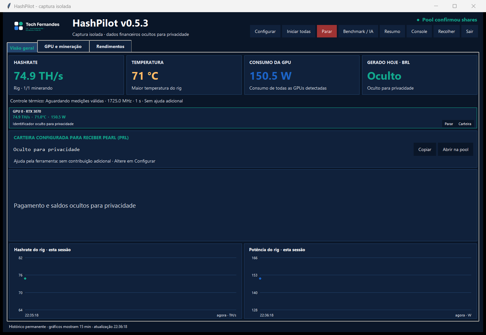

# HashPilot — Tech Fernandes

[Português](README.md) · [Website](https://techfernandesltda.github.io/hashpilot/en/) | [Documentation](docs/index.md) · [Windows installation](docs/installation.md) · [LLM entry point](llms.txt)

A Windows desktop monitor for Pearl (PRL) mining, with NVIDIA telemetry, history and support for up to six GPUs. **Prerelease:** physically validated on one RTX 3070; six-GPU scenarios are simulated. [Requirements and installation](#windows-installation) · [Evidence and limits](#hardware-support).

**Before mining:** the default wallet belongs to the author, who receives payouts sent to it. Enter your own public address to receive payouts yourself. The optional contribution of up to 5% of connected time can be disabled. Never enter a seed phrase or private key.

The setup dialog includes [verified application updates](docs/update.md), preserving existing data, and [miner security guidance](docs/defender.md) with an optional administrator-confirmed exception for one executable path. An official hash is not a safety certification; Defender settings never change automatically.

**[Download v0.5.4 — prerelease](https://github.com/TechFernandesLTDA/hashpilot/releases/tag/v0.5.4)** · [All releases](https://github.com/TechFernandesLTDA/hashpilot/releases) · [Verify SHA-256 and evidence](docs/verification.md)

## Windows installation

Run in PowerShell on **Windows 10/11 x64**, with `winget` available:

```powershell
irm https://raw.githubusercontent.com/TechFernandesLTDA/hashpilot/v0.5.4/install.ps1 | iex
```

The installer prepares mise/Python, installs into `%LOCALAPPDATA%\Programs\HashPilot`, creates shortcuts, and opens setup. Existing local settings and history are preserved. See the [installation guide](docs/installation.md) for requirements and troubleshooting.

**The author's receiving address is the default.** Keeping it sends mining payouts to the author. Enter your own public receiving address in setup before mining; setup can be reopened. No seed phrase or private key is needed. Miner installation is a separate option; installing the dashboard alone does not start mining.



Isolated v0.5.3 capture with real RTX 3070 telemetry; balances, forecasts, wallet and identifiers are hidden for privacy. [GPU and mining](media/current/gpu-mining.png) · [Capture provenance](media/current/README.md).

<details>
<summary>Historical media / Arquivo de demonstracoes</summary>

[▶ Watch the historical v0.1.0 44-second demo (MP4, English captions)](media/hashpilot-demo.mp4) · [Measured RTX 3070 results](docs/performance/rtx3070.md)


| GPU and mining | Earnings |
|---|---|
|  |  |

The video and screenshots document **v0.1.0 with one GPU**, rendered from real local data. The current version adds an up-to-six-GPU panel. Historical media does not constitute physical validation of six devices. [Capture provenance](media/README.md).

**One RTX 3070, 15-minute observation:** 78.40 TH/s mean, 159.06 W mean, 75.08 °C mean, fan 100%, configured power limit 240 W. Based on 448 sensor samples and 10 independent hashrate updates. These are observed results from one device, not an A/B comparison, universal preset or profit guarantee. [Method and evidence](docs/performance/rtx3070.md).


</details>

## Dashboard

| Tab | Contents |
|---|---|
| Overview | Hashrate, temperature, power, observed credits, receiving address and next payout |
| GPU and mining | NVIDIA sensors, clocks, fans, thermal control, charts and recent events |
| Earnings | Observed periods, pool balances, PRL/BRL/USD/BTC equivalents and projections |

SQLite history survives restarts and has no automatic expiry. Windows includes a tray icon, compact summary and text console. Local collection runs every 2 seconds; public pool/price requests run every 60 seconds with timestamps and cache status.

Currency values are current-price equivalents, not executed exchanges. **Pool payouts remain in PRL.** Projections are estimates, and incomplete observation periods are marked partial.

## Hardware support

GPU telemetry requires **NVIDIA `nvidia-smi`**. A **Windows RTX 3070** is the validated reference mining profile. Its measured results do not validate other cards or operating conditions.

The [NVIDIA catalog](docs/gpu-catalog.md) contains **158 models with primary sources**. This validates source provenance, not overclocks on every card. The [local agent](docs/gpu-agent.md) identifies devices by driver/UUID, measures a 300-second baseline, and supports manual benchmarking and explicit adaptive control. CPU-based Ollama is optional and requires no paid API.

The dashboard identifies **up to six GPUs by persistent UUID**, including identical models. Every device has an enable/disable setting, a global or individual wallet, its own miner, controller and benchmark. Newly detected devices default to enabled in configuration; **opening the UI never starts mining**. The rig service requires an explicit start. Once authorized, it reconciles the selected devices and stops only the processes belonging to a disabled GPU. Additional devices beyond six are reported and ignored. The UI asks for confirmation when starting with the author wallet; while the service is already active, a newly detected GPU can be enabled automatically with its configured wallet. Check wallets before connecting a new device. [Multi-GPU operation](docs/multi-gpu.md).

Hashrate and power can be summed across devices. Actual credits are collected and deduplicated **by wallet**: two GPUs using the same address never duplicate its balance. Hashrate is not used to fabricate per-device realized earnings. Physical evidence remains limited to one RTX 3070; six-device scenarios use simulated tests.

The product supports **Windows 10/11 x64 only**. See [backup and transfer between Windows computers](PORTABILIDADE.md).

## Optional contribution

For an address other than the author's, an optional, disableable contribution reserves **up to 5% of connected time**: after 57 authorized minutes for you, up to 3 for the author. Setup displays the option. A TCP proxy switches the destination without restarting the GPU or miner. The author's default address receives no additional split. This is separate from SRBMiner's 2% developer fee. Forecasts deduct the expected contribution when enabled; actual observed credits are never deducted twice. **It does not withdraw existing balances or guarantee exactly 5% of coins. Real credit and payout validation remains pending.** [Details](docs/contribution.md) · [v0.3.4 assessment](docs/qa/2026-10-25-contribuicao.md).

## From source

```text
mise install
mise exec -- python monitor.py
mise exec -- python -m unittest discover -v
```

The public repository includes the author's public address and an explicitly authorized historical snapshot in `portable-data/`. That snapshot is dated reference data, not earnings produced by your machine. Initial restoration never replaces an existing local database.

Local data: `%LOCALAPPDATA%\PearlMonitor`.

[Architecture](docs/architecture.md) · [Technical reference](docs/reference.md) · [FAQ](docs/faq.md) · [Contributing](CONTRIBUTING.md) · [Security](SECURITY.md)

Code is licensed **GPL-3.0-only**: [LICENSE](LICENSE). Tech Fernandes names and logos are not licensed under GPL; see [NOTICE](NOTICE) and [brand provenance](assets/brand/ORIGEM.md).

AI providers / Provedores de IA: [OpenRouter Cloud Free, OpenCode Cloud Free e Ollama local](docs/ai-providers.md). A política adaptativa funciona sem IA.

## Verification and evidence

[Release verification, deterministic source packaging, diagnostic export and 24/72-hour observation protocol](docs/verification.md). Physical evidence still covers one RTX 3070; multi-GPU tests are simulated. Checksums are not publisher signatures or an independent security audit. [v0.5.4 notes](docs/releases/v0.5.4.md).

[Discussions and Q&A](https://github.com/TechFernandesLTDA/hashpilot/discussions) | [External testing](docs/external-testing.md) | [Adoption and metrics](docs/adoption.md)
