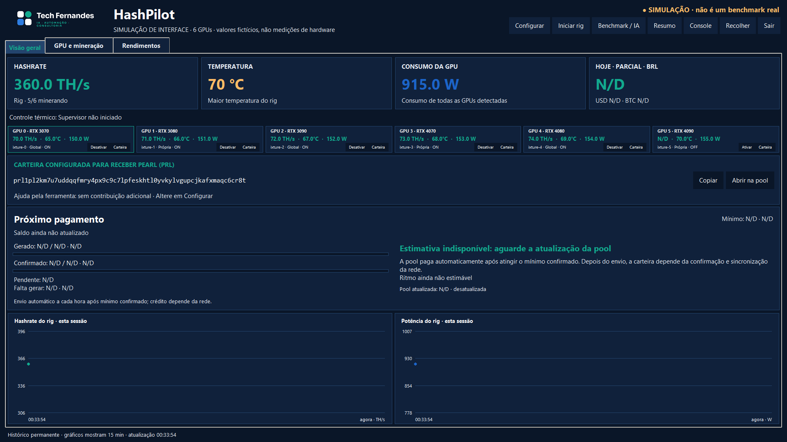
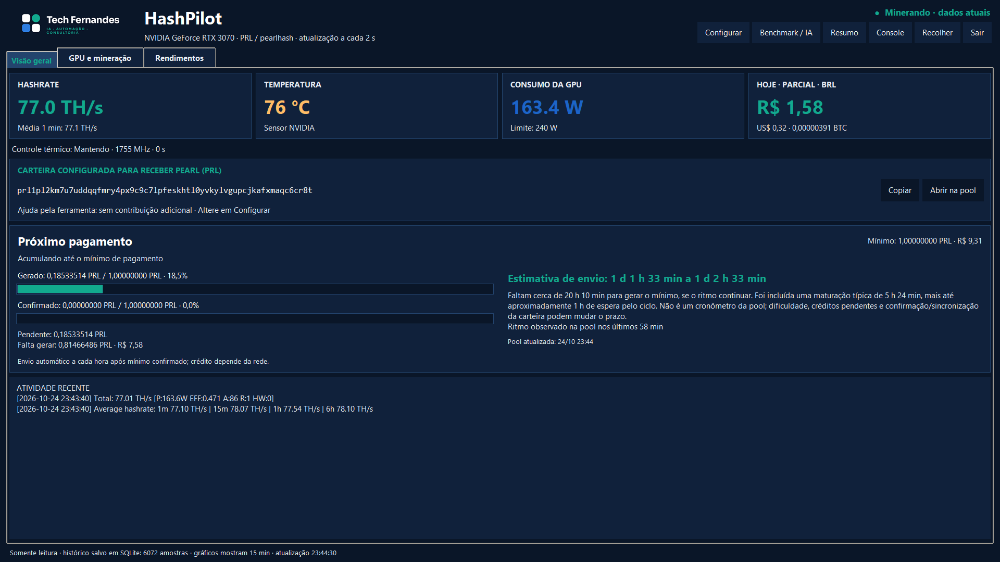
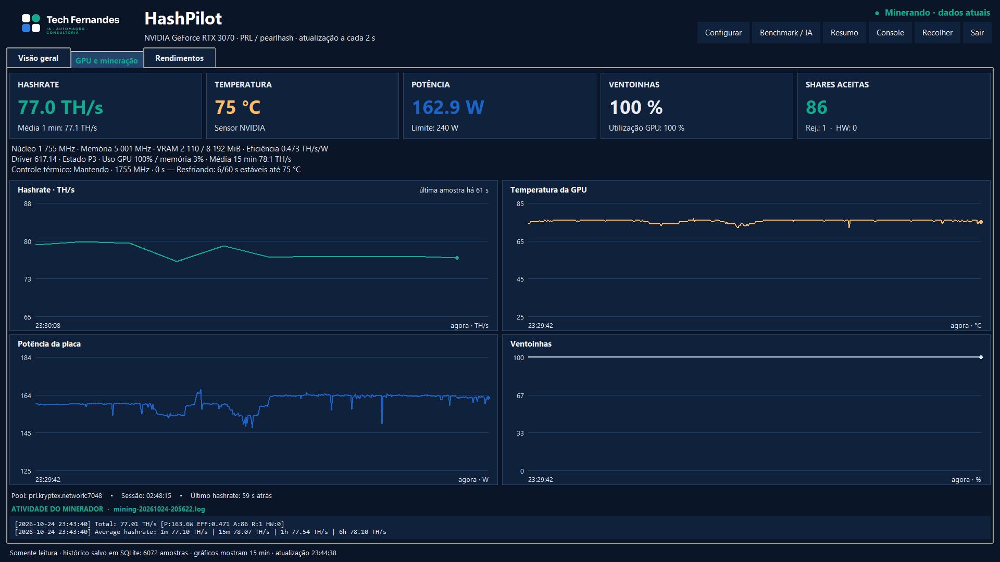
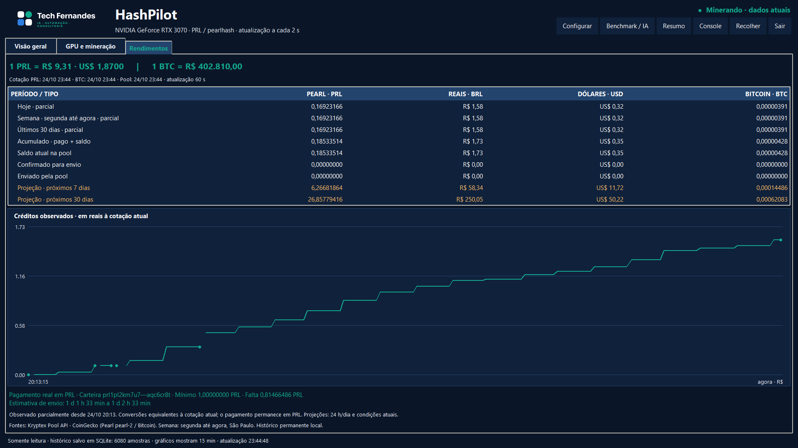

# HashPilot — Tech Fernandes

[English](README.en.md) · [Documentação](docs/index.md) · [Instalação](docs/installation.md) · [Para LLMs](llms.txt)

**[Baixar v0.3.7 — pré-lançamento](https://github.com/TechFernandesLTDA/hashpilot/releases/tag/v0.3.7)** · [Todas as releases](https://github.com/TechFernandesLTDA/hashpilot/releases) · [Verificar SHA-256 e evidências](docs/verification.md)


Monitor local de mineração Pearl (PRL) para **até seis GPUs NVIDIA**, iguais ou diferentes: telemetria e benchmark por placa, ajuste dinâmico, histórico permanente e rendimentos equivalentes em **PRL, BRL, USD e BTC**. Interface desktop Python/Tkinter para Windows, sem servidor web ou dependências Python adicionais para o monitor.

## Veja o aplicativo



Painel multiGPU da v0.2.0: **simulação de seis placas**, com valores fictícios. [Captura com a RTX 3070 real](media/v0.2.0/overview-real-rtx3070.png) · [Operação e limites da validação](docs/multi-gpu.md).

[▶ Demonstração de 44 segundos — vídeo MP4 com legendas em inglês](media/hashpilot-demo.mp4) · [Resultado real da RTX 3070 e metodologia](docs/performance/rtx3070.md)



| GPU e mineração | Rendimentos |
|---|---|
|  |  |

O vídeo e estas capturas documentam a **versão v0.1.0, com uma GPU**, em uma janela isolada alimentada por dados locais reais. A versão atual acrescenta o painel de até seis GPUs. A mídia histórica não representa uma validação física de seis placas. [Origem e reprodução da mídia](media/README.md).

## Instalar no Windows

No PowerShell do **Windows 10/11 x64**, com `winget` disponível:

```powershell
irm https://raw.githubusercontent.com/TechFernandesLTDA/hashpilot/v0.3.7/install.ps1 | iex
```

O instalador prepara o mise/Python, instala o aplicativo em `%LOCALAPPDATA%\Programs\HashPilot`, cria atalhos e abre o assistente de configuração. Configurações e histórico existentes são preservados. [Passos, requisitos e solução de problemas](docs/installation.md).

Em **Configurar**, consulte [Atualizações](docs/update.md) para instalar novas releases sem zerar configurações ou histórico, e [Segurança do minerador](docs/defender.md) para entender detecções e solicitar uma exceção local opcional com consentimento e confirmação administrativa. O HashPilot não declara o minerador seguro apenas por ter origem oficial e não altera o Defender automaticamente.

**Carteira padrão: a do autor.** Se você mantiver esse endereço, os pagamentos irão para o autor. Troque pela sua carteira pública no assistente antes de minerar; a configuração pode ser reaberta. O monitor não precisa de seed ou chave privada. A instalação do minerador é uma opção separada: não começa apenas por instalar o painel.

## O que acompanha

| Aba | Informações |
|---|---|
| **Visão geral** | Hashrate, temperatura, consumo, créditos observados, carteira e próximo pagamento |
| **GPU e mineração** | Sensores NVIDIA, clocks, ventoinhas, controle térmico, gráficos e eventos |
| **Rendimentos** | Períodos observados, saldo da pool, valores em PRL/BRL/USD/BTC e projeções |

- Histórico SQLite preservado após reinícios; sem expurgo automático.
- Bandeja do Windows, resumo compacto e console textual.
- Coleta local a cada 2 s; pool e cotações públicas a cada 60 s, com idade/cache visíveis.
- Projeções são estimativas. Valores em USD/BTC são equivalentes; **o pagamento continua em PRL**.

## Hardware e Windows

O monitor de hardware usa **NVIDIA `nvidia-smi`**. A **RTX 3070 no Windows** é o perfil de mineração validado de referência deste projeto. Os resultados dessa unidade não certificam outras placas ou ambientes.

**Observação real de 15 minutos:** média de **78,40 TH/s**, **159,06 W** e **75,08 °C**, com ventoinhas em 100% e limite de potência configurado em 240 W. Foram 448 amostras de sensores e 10 atualizações independentes de hashrate. É uma observação desta unidade, sem comparação A/B ou promessa de lucro. [Relatório e evidências](docs/performance/rtx3070.md).

O [catálogo NVIDIA](docs/gpu-catalog.md) reúne **158 modelos com fontes primárias**. Isso valida a origem dos dados, não o overclock de cada placa. O [agente local](docs/gpu-agent.md) identifica GPUs pelo driver/UUID, mede uma baseline de 300 s e permite benchmark manual e controle adaptativo explícito. Ollama na CPU é opcional, sem API paga.

O painel identifica **até seis placas por UUID persistente**, mesmo quando são do mesmo modelo. Cada GPU possui opção de habilitar/desabilitar, carteira herdada da configuração global ou endereço próprio, minerador, supervisor e benchmark separados. Placas novas ficam habilitadas na configuração; **abrir o painel não inicia mineração**. O serviço do rig é iniciado explicitamente. Depois de autorizado, reconciliará a seleção e encerrará somente os processos da GPU desabilitada. Dispositivos além do limite de seis são informados e ignorados. [Operação multiGPU](docs/multi-gpu.md).

Hashrate e potência podem ser somados por GPU. Créditos reais são consultados e deduplicados **por carteira**: duas placas no mesmo endereço não duplicam o saldo, e hashrate não é usado para inventar ganhos individuais. A validação física disponível continua sendo uma RTX 3070; cenários com seis placas usam testes simulados.

O produto é exclusivo para **Windows 10/11 x64**. Veja [backup e transferência entre computadores Windows](PORTABILIDADE.md).

## Contribuição opcional

Com uma carteira diferente da do autor, a contribuição opcional e desativável reserva **até 5% do tempo conectado**: após 57 minutos autorizados para você, até 3 para o autor. Ela fica visível no assistente e usa proxy TCP, sem reiniciar a GPU ou o minerador. A carteira padrão do autor não recebe uma divisão adicional. Isso é separado da devfee de 2% do SRBMiner. As projeções descontam a contribuição esperada quando ativa; créditos reais observados não são descontados novamente. **Não retira saldo existente nem garante exatamente 5% das moedas. A validação de crédito e pagamento reais ainda está pendente.** [Como funciona](docs/contribution.md) · [Avaliação da v0.3.4](docs/qa/2026-10-25-contribuicao.md).

## Verificação e evidências

[Verificar a release e reproduzir o pacote](docs/verification.md) · [Protocolo de estabilidade de 24/72 horas](docs/verification.md#protocolo-de-estabilidade-de-24-e-72-horas) · [Notas da v0.3.7](docs/releases/v0.3.7.md). Hashes não substituem assinatura de publicador ou revisão independente.

## Código e dados

```text
mise install
mise exec -- python monitor.py
mise exec -- python -m unittest discover -v
```

O snapshot em `portable-data/` pertence ao autor e foi incluído com autorização, assim como seu endereço público. Ele é uma fotografia datada, não o rendimento do seu computador. A restauração inicial não substitui um banco local existente. [Arquitetura](docs/architecture.md) · [Referência técnica](docs/reference.md).

Dados locais: `%LOCALAPPDATA%\PearlMonitor`.

## Participar

[Contribuir](CONTRIBUTING.md) · [Reportar bug](https://github.com/TechFernandesLTDA/hashpilot/issues/new?template=bug_report.yml) · [Pedir recurso](https://github.com/TechFernandesLTDA/hashpilot/issues/new?template=feature_request.yml) · [Segurança](SECURITY.md)

O código está sob **GPL-3.0-only**: [LICENSE](LICENSE). A marca e os logos Tech Fernandes não são licenciados sob GPL; veja [NOTICE](NOTICE) e a [origem dos ativos](assets/brand/ORIGEM.md).

AI providers / Provedores de IA: [OpenRouter Cloud Free, OpenCode Cloud Free e Ollama local](docs/ai-providers.md). A política adaptativa funciona sem IA.
