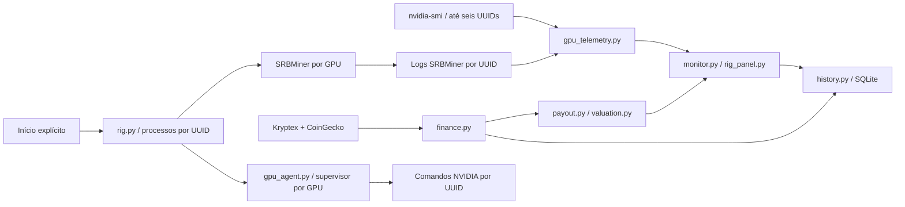

# Arquitetura

O HashPilot separa coleta, apresentação, cálculo financeiro, persistência e controle do minerador. A interface desktop não usa um servidor HTTP local.

## Pontos de entrada

| Arquivo | Responsabilidade |
|---|---|
| `install.ps1` | Instalação Windows, Python gerenciado pelo mise, versão do aplicativo e atalhos |
| `monitor.py` | Aplicação Tk, três abas, coleta local, resumo e console |
| `monitor_layout.py` / `monitor_chart.py` / `monitor_format.py` / `monitor_sensors.py` / `monitor_theme.py` | Construção das abas GPU e Rendimentos, gráfico, formatação (ausente = N/D), leituras do modo legado e cores |
| `onboarding.py` | Assistente de configuração, carteira e escolha explícita das opções de instalação/mineração |
| `Abrir-Monitor.ps1` | Lançador relativo Windows, com `-Resumo` e `-Console` |

## Módulos

| Módulo | Contrato |
|---|---|
| `config.py` | Configuração local e caminhos por plataforma; endereço público padrão do autor |
| `bootstrap.py` | Restaura o snapshot incluído apenas quando os arquivos locais de destino não existem |
| `finance.py` | Consultas públicas, cache e snapshots de saldo/recompensas |
| `valuation.py` | Conversões indicativas PRL → BRL/USD/BTC, sem operações financeiras |
| `payout.py` | Progresso para o mínimo confirmado e estimativa de envio |
| `history.py` | Escrita SQLite em thread própria, eventos, migração e recuperação |
| `thermal.py` | Política pura: temperatura e timestamp entram; decisão de clock sai |
| `thermal_controller.py` | Aplicação real das decisões NVIDIA no perfil suportado |
| `gpu_agent.py` | Detecção por UUID, benchmark persistente, supervisor NVIDIA explícito e consultor Ollama opcional |
| `gpu_telemetry.py` | Consulta NVIDIA em lote e parser de log atribuído a uma única GPU |
| `miner_log.py` | Formato do log do SRBMiner (carimbo, hashrate, médias, contadores, mapa PCI); contrato testado com log real em `test_miner_log.py` |
| `nvidia_smi.py` | Localização única do `nvidia-smi` (PATH e System32) |
| `rig_config.py` | Seleção de até seis UUIDs, habilitação e herança de carteira |
| `rig.py` / `rig_controller.py` | Ciclo de vida dos processos por GPU, fila de pedidos e snapshots isolados |
| `process_backend.py` | Criação, identidade (PID, criação, executável) e encerramento seguro de processos no Windows |
| `reference_profile.py` | Opt-in da RTX 3070 de referência do autor (UUID fixo); separado do fluxo genérico |
| `fsutil.py` | Escrita atômica de JSON (`atomic_json`) |
| `app_logging.py` | Diagnóstico local rotativo: `hashpilot.log` (painel) e `rig-service.log` (serviço), com traceback |
| `data_contracts.py` | Contratos `TypedDict` conferidos por `mypy` nos módulos de dados |
| `rig_panel.py` | Seleção e informações individuais das GPUs na interface |
| `data/nvidia-gpus.json` | 158 modelos com proveniência NVIDIA; não contém presets universais de overclock |
| `tray.py` | Ícone e menu nativos Windows, com eventos enviados à thread Tk |

Leituras locais normalmente ocorrem a cada 2 s. A taxa de hash mantém o horário real publicado pelo minerador, que pode atualizar em intervalos maiores. Pool e cotações usam um ciclo de 60 s. Ausência e desatualização são estados explícitos, não zeros inventados.

## Persistência

- Windows: `%LOCALAPPDATA%\PearlMonitor` — nome legado mantido para compatibilidade.
- O produto suporta somente Windows 10/11 x64.

`history.sqlite3` usa WAL e, desde a v0.5.6, `synchronous=NORMAL`. A fila de escrita tenta novamente se o banco estiver ocupado; a interface continua responsiva. O fechamento normal aguarda gravações pendentes. Commits concluídos sobrevivem ao encerramento forçado do processo; numa queda de energia, os últimos commits podem ser perdidos, sem corromper o banco. Linhas do log entram em lotes, e a posição já arquivada de cada log fica em `history-log-offsets.json`, gravada somente depois do commit; sem esse arquivo, o log é relido e a chave por hash evita duplicatas. As linhas brutas do log são arquivadas uma vez em `events`; as amostras de 2 s, inclusive `gpu_telemetry`, não copiam `recent_logs` nem `rate_points`.

Com o serviço do rig ativo, o painel usa o `latest.json` recém-gravado por GPU (até 5 s) em vez de consultar o driver e reprocessar o log; sem esse snapshot, faz a consulta direta. Capacidades fixas da GPU são consultadas uma vez por placa e reaproveitadas por até 10 min.

Os registros são separados por carteira e sessão; as tabelas `gpu_devices` e `gpu_telemetry` preservam também a identidade e as observações por UUID. O histórico anterior de uma GPU permanece disponível e sua importação não deve duplicar linhas. Não há expurgo automático. A janela de 15 minutos dos gráficos e o cache financeiro de trabalho de 35 dias não apagam o arquivo permanente. `latest.json` e `finance-latest.json` são resumos, não substitutos do banco.

O snapshot em `portable-data/` é do autor e tem um manifesto datado. O bootstrap o restaura somente em um perfil sem banco/cache de destino. Restaurar não mescla bancos diferentes nem sobrescreve um banco existente.

## Semântica financeira

Créditos observados vêm da variação de **total enviado pela pool + saldo atual**, incluindo a parcela pendente. Um envio que reduz o saldo e aumenta o total pago não é contado novamente como receita. Isso difere de estimar renda por hashrate.

Períodos sem cobertura suficiente são parciais; fronteiras de calendário não são preenchidas com ganhos inventados. Os equivalentes BRL/USD/BTC usam cotações atuais. A pool continua enviando PRL.

O ETA combina saldo faltante, ritmo observado com cobertura suficiente ou projeção por rede, maturação típica e ciclo de pagamento. Não é um horário garantido para confirmação na carteira. [Regras detalhadas](../PAGAMENTOS.md).

## Fronteira de hardware

A coleta NVIDIA é uma leitura. Instalar/iniciar o minerador e aplicar clocks são ações separadas. O supervisor real e os scripts de `mining/windows/` são específicos do perfil Windows suportado; a política pura pode ser testada sem hardware.

A RTX 3070 é a referência de hardware validada. O [catálogo](gpu-catalog.md) documenta 158 modelos com fontes primárias, sem validar overclocks. O [agente](gpu-agent.md) mede baseline de 300 s, aceita novo benchmark manual e separa medições por UUID. `--control` habilita o supervisor explicitamente; detecção e benchmark de observação não escrevem na GPU. Ollama na CPU é opcional e não substitui a validação das propostas.

O runtime acompanha **até seis GPUs NVIDIA**, iguais ou diferentes, por UUID persistente. Uma consulta em lote coleta sensores, enquanto cada instância de minerador tem seu log, supervisor e benchmark. O índice do SRBMiner pode diferir do índice do driver: a associação precisa ser confirmada pelo barramento PCI. Totais e médias globais de um log compartilhado não substituem medições individuais.

O serviço do rig precisa ser iniciado explicitamente; abrir a interface não inicia processos de mineração. Uma GPU nova fica habilitada na configuração por padrão, mas só passa a minerar quando o serviço autorizado a inicia. Alterações de habilitação são reconciliadas por GPU. O gerenciador conserva a identidade dos processos que criou e não encerra processos alheios ou PIDs reutilizados.

`rig-manager.json` e `rig-requests/` ficam no diretório local do aplicativo. Cada UUID possui um diretório em `LOG_DIR/gpus/<UUID>/` com logs, status, `latest.json`, controle exclusivo e `gpu-agent.sqlite3`. Carteiras usam a configuração global ou um override em `gpu_settings`. Veja [caminhos e contratos](multi-gpu.md).

O novo iniciador parte dos ajustes atuais do driver, sem copiar clocks RTX 3070. O iniciador histórico e `thermal_controller.py` continuam separados como referência; não se executam dois supervisores concorrentes na mesma GPU. Migração de uma sessão antiga é uma ação própria, com verificação de identidade e preservação dos logs; atualizar a interface não autoriza assumir um processo externo.

Consultas financeiras são deduplicadas por carteira efetiva. Se seis GPUs usam o mesmo endereço, o saldo é contado uma vez. Carteiras distintas possuem coletores e períodos próprios; ganhos reais por placa não são inferidos da participação no hashrate.

## Contribuição de tempo

A opção visível e desativável de contribuição usa proxy TCP para alternar 57 minutos de mineração para a carteira configurada e 3 minutos para o autor, sem reiniciar GPU ou minerador. Não aplica divisão adicional quando a carteira configurada já é a do autor. A devfee de 2% do SRBMiner é distinta. Projeções deduzem os 5% esperados somente quando a opção está ativa; os créditos efetivos da pool já refletem o destino e não recebem novo desconto. [Contrato e configuração](contribution.md).

## Testes

`mise exec -- python -m unittest discover -v` (ou `python tools/run_tests.py` em qualquer sistema: estado temporário isolado e testes dependentes de APIs do Windows pulados com motivo) cobre gráficos, finanças, conversões, pagamentos, política térmica, restauração e durabilidade. QA de interface e maximização é opt-in: `test_responsive_ui.py --run` e `test_windowing.py --run`. Usam janelas próprias e dados temporários, sem iniciar mineração.

`python tools/check_style.py` roda `ruff` (erros reais em todo o repositório e formatação dos módulos novos) e `mypy` estrito nos módulos de `mypy.ini`; são ferramentas opcionais de desenvolvimento, chamadas pelo `pre-push`.

Os relatórios devem distinguir monitor físico, área útil, cliente real, DPI e simulação 4K. [Como contribuir](../CONTRIBUTING.md).

AI providers / Provedores de IA: [OpenRouter Cloud Free, OpenCode Cloud Free e Ollama local](ai-providers.md). A política adaptativa funciona sem IA.
