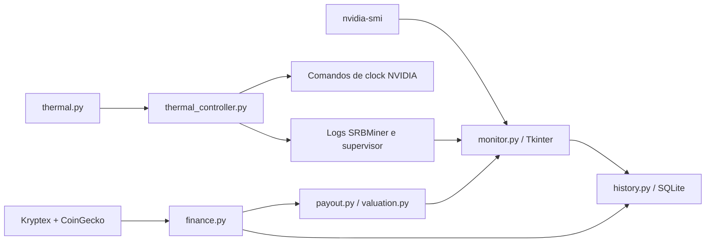

# Arquitetura

O HashPilot separa coleta, apresentação, cálculo financeiro, persistência e controle do minerador. A interface desktop não usa um servidor HTTP local.

## Pontos de entrada

| Arquivo | Responsabilidade |
|---|---|
| `install.ps1` | Instalação Windows, Python gerenciado pelo mise, versão do aplicativo e atalhos |
| `monitor.py` | Aplicação Tk, três abas, coleta local, resumo e console |
| `onboarding.py` | Assistente de configuração, carteira e escolha explícita das opções de instalação/mineração |
| `Abrir-Monitor.ps1` | Lançador relativo Windows, com `-Resumo` e `-Console` |
| `Abrir-HashPilot.command` | Lançador macOS; não instala mineração Apple |

## Módulos

| Módulo | Contrato |
|---|---|
| `config.py` | Configuração local e caminhos por plataforma; endereço público padrão do autor |
| `bootstrap.py` | Restaura o snapshot incluído apenas quando os arquivos locais de destino não existem |
| `finance.py` | Consultas públicas, cache e snapshots de saldo/recompensas |
| `valuation.py` | Conversões indicativas PRL → BRL/USD/BTC, sem operações financeiras |
| `payout.py` | Progresso para o mínimo confirmado e estimativa de envio |
| `history.py` | Escrita SQLite em thread própria, eventos, migração e recuperação |
| `thermal.py` | Política pura: temperatura e timestamp entram; decisão de clock sai |
| `thermal_controller.py` | Aplicação real das decisões NVIDIA no perfil suportado |
| `gpu_agent.py` | Detecção por UUID, benchmark persistente, supervisor NVIDIA explícito e consultor Ollama opcional |
| `data/nvidia-gpus.json` | 158 modelos com proveniência NVIDIA; não contém presets universais de overclock |
| `tray.py` | Ícone e menu nativos Windows, com eventos enviados à thread Tk |

Leituras locais normalmente ocorrem a cada 2 s. A taxa de hash mantém o horário real publicado pelo minerador, que pode atualizar em intervalos maiores. Pool e cotações usam um ciclo de 60 s. Ausência e desatualização são estados explícitos, não zeros inventados.

## Persistência

- Windows: `%LOCALAPPDATA%\PearlMonitor` — nome legado mantido para compatibilidade.
- macOS: `~/Library/Application Support/HashPilot`.
- Outros sistemas: caminho definido em `config.py`; isso não significa validação de mineração nessa plataforma.

`history.sqlite3` usa WAL e `synchronous=FULL`. A fila de escrita tenta novamente se o banco estiver ocupado; a interface continua responsiva. O fechamento normal aguarda gravações pendentes. Commits concluídos sobrevivem ao encerramento forçado do processo.

Os registros são separados por carteira e sessão. Não há expurgo automático. A janela de 15 minutos dos gráficos e o cache financeiro de trabalho de 35 dias não apagam o arquivo permanente. `latest.json` e `finance-latest.json` são resumos, não substitutos do banco.

O snapshot em `portable-data/` é do autor e tem um manifesto datado. O bootstrap o restaura somente em um perfil sem banco/cache de destino. Restaurar não mescla bancos diferentes nem sobrescreve um banco existente.

## Semântica financeira

Créditos observados vêm da variação de **total enviado pela pool + saldo atual**, incluindo a parcela pendente. Um envio que reduz o saldo e aumenta o total pago não é contado novamente como receita. Isso difere de estimar renda por hashrate.

Períodos sem cobertura suficiente são parciais; fronteiras de calendário não são preenchidas com ganhos inventados. Os equivalentes BRL/USD/BTC usam cotações atuais. A pool continua enviando PRL.

O ETA combina saldo faltante, ritmo observado com cobertura suficiente ou projeção por rede, maturação típica e ciclo de pagamento. Não é um horário garantido para confirmação na carteira. [Regras detalhadas](../PAGAMENTOS.md).

## Fronteira de hardware

A coleta NVIDIA é uma leitura. Instalar/iniciar o minerador e aplicar clocks são ações separadas. O supervisor real e os scripts de `mining/windows/` são específicos do perfil Windows suportado; a política pura pode ser testada sem hardware.

A RTX 3070 é a referência de hardware validada. O [catálogo](gpu-catalog.md) documenta 158 modelos com fontes primárias, sem validar overclocks. O [agente](gpu-agent.md) mede baseline de 300 s, aceita novo benchmark manual e separa medições por UUID. `--control` habilita o supervisor explicitamente; detecção e benchmark de observação não escrevem na GPU. Ollama na CPU é opcional e não substitui a validação das propostas.

O runtime do painel e o iniciador padrão usam **GPU0**. Perfis por UUID no motor não significam coleta mult GPU na interface; hashrate agregado não deve ser reutilizado como medição de outra placa. O novo iniciador parte dos ajustes atuais do driver, sem copiar clocks RTX 3070. O iniciador histórico e `thermal_controller.py` continuam separados como referência; não se executam dois supervisores concorrentes. Não há suporte de mineração Apple implícito na portabilidade da interface.

## Testes

`mise exec -- python -m unittest discover -v` cobre gráficos, finanças, conversões, pagamentos, política térmica, restauração e durabilidade. QA de interface e maximização é opt-in: `test_responsive_ui.py --run` e `test_windowing.py --run`. Usam janelas próprias e dados temporários, sem iniciar mineração.

Os relatórios devem distinguir monitor físico, área útil, cliente real, DPI e simulação 4K. [Como contribuir](../CONTRIBUTING.md).
