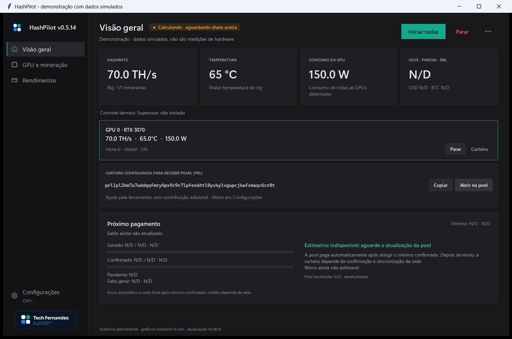

# v0.5.15 — Interface nova

O painel foi redesenhado por inteiro. O comportamento é o mesmo: nenhuma ação, dado, atalho ou regra de mineração mudou.

*Dados simulados de demonstração; não são medições de hardware.*

## O que mudou

- **Barra lateral no lugar das abas.** Visão geral, GPU e mineração e Rendimentos ficam na barra lateral esquerda; Configurações fica no rodapé dela (Ctrl+,). A página aberta por último continua sendo lembrada.
- **Tema grafite neutro.** Superfícies escuras neutras, cartões com borda fina e o teal da Tech Fernandes como único acento. Projeções continuam em âmbar, para não parecerem crédito realizado.
- **Cabeçalho de página.** Título, estado da mineração numa pílula, "Iniciar todas" como ação principal e "Parar" em vermelho discreto.
- **Mesmo padrão em todas as telas.** Configurações, Central de operação, assistente inicial, janela de parar, Defender, IA, atualizações, minerador e benchmark usam os mesmos componentes. "Parar TODAS e restaurar" é o único botão vermelho preenchido.
- **Tipografia.** Segoe UI Variable no Windows 11, com queda para Segoe UI no Windows 10.

## Por dentro

- Cores, fontes, espaçamentos e raios saem de `monitor_theme.py`; os componentes reutilizados (botões, cartões, item de barra lateral, pílula, campo de texto, estilos ttk) ficam no módulo novo `ui_kit.py`. Os módulos de interface não têm mais cor nem fonte fixa.
- A janela de GPUs cresce para mostrar seis placas sem cortar a última linha.
- `tools/qa_stopped_miner.py` voltou a passar: a verificação esperava um texto de rodapé alterado na v0.5.8.
- As capturas públicas (README, site e `media/current/`) mostram o visual novo com dados simulados: uma GPU fictícia, sem saldos.

## Evidência e limites

A suíte Python (553 testes), os testes e a paridade em Rust, as oito ferramentas de QA de layout (de 1280×720 até a área útil de 2544×1336 px a 166 % de DPI), a verificação de documentação, a análise dos scripts PowerShell e a busca de segredos passaram antes da publicação. Monitor 4K físico não foi testado. Tabela, menu de opções e abas internas continuam sendo controles nativos do Tkinter. Somente uma RTX 3070 foi validada fisicamente; cenários de duas a seis GPUs são simulados. A troca de interface não reinicia a mineração nem o serviço do rig.
